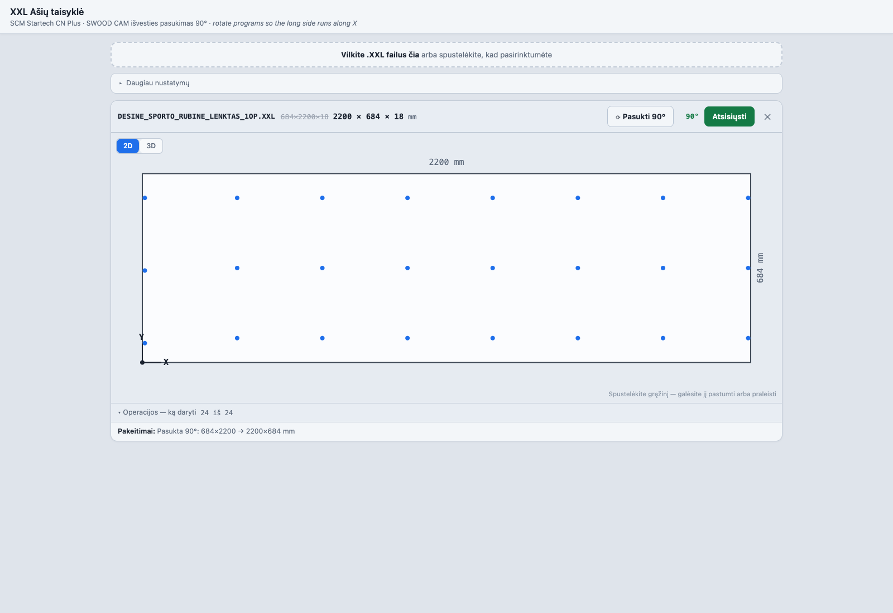

# XXL Ašių taisyklė — a 90° rotation that removes a daily manual fix

**Rotates SWOOD CAM `.XXL` part programs so the long side runs along the machine's X axis.**
For an SCM Startech CN Plus. Drop the file in, download the fixed one.



> 🇱🇹 Lietuviškas aprašymas: [README.lt.md](README.lt.md)

## The problem

SWOOD exports a part in the orientation it has in the *model*, not the orientation the
*machine* accepts. Example — `DESINE_SPORTO_RUBINE_LENKTAS_1OP.XXL`:

```
H DX=684 DY=2200 DZ=18 ...        <-- DY 2200 mm doesn't fit the Y travel
```

So somebody turns it by hand. Every time.

## Don't assume the rule — prove it

Before automating this I parsed **1,284 programs that had actually been cut on this machine**:

| | value |
|---|---|
| largest `DX` used | **2746 mm** |
| largest `DY` used | **1015 mm** |
| programs where `DY > DX` | 125 (9.7 %) — all of them fit within Y |
| programs with `DY > 1300` | **0** |

Y is the short axis, and nothing real has ever needed more than 1015 mm of it. `DY=2200` is
physically impossible, so rotating it is not a heuristic — it's the only valid output. That's
what made it safe to do automatically.

## What it does

Four steps, one screen:

1. **Drop** a `.XXL` file. If the part is lying across the axes (`DY > DX`) it is **rotated
   immediately** — that's the whole point of opening it.
2. **See it** — 2D drawing of the panel with every drilling and routing operation placed, plus
   a 3D view. Click a hole to nudge or skip it.
3. **Check** — the operations list shows what will be written and what will be dropped.
4. **Download** the corrected program.

It rewrites the header, rotates every operation's coordinates, remaps the face/edge codes and
arc directions, and stamps the file so you can tell a fixed program from an original.

Also handles thickness override and edge/routing operations, with fixtures covering SWOOD and
Maestro output.

## Make a part by hand

**`＋ Nauja detalė`** (top right) opens a part builder, so the workshop can make a program
without the engineer or SolidWorks: set the panel size, add holes (Ø5/8/15/35, blind or
through), shelf-pin rows, hinge cups, edge holes, grooves, corner notches, cut-outs and round
holes, position each one **from the edge it was measured from**, drag it on the drawing, and
download or send the programs straight to the machine.

It writes exactly what step2xxl writes (same lines, same face numbering, `_1OP`/`_2OP`/`_3OP`)
and follows the same machine rules: underside work goes to a turned-over 2OP, Ø5 in a long edge
to a 90°-rotated program, routing always leaves 2 mm, ramps in instead of plunging and never
goes more than 20 mm outside the panel. Invalid parts can't be downloaded; every check says
why in plain Lithuanian.

## Run it

```bash
python3 serve.py          # http://localhost:8748/
```

Tests: <http://localhost:8748/test.html> — **375 checks** against real `.XXL` fixtures in
[`fixtures/`](fixtures) (SWOOD portrait/edges, Maestro arcs/edges/routing).

There's a `windows/` folder with a double-click launcher for the shop PC, because the person
using this shouldn't have to know what a terminal is.

## Built with

Vanilla JavaScript, HTML Canvas, no dependencies, no build step. ~3,300 lines.
